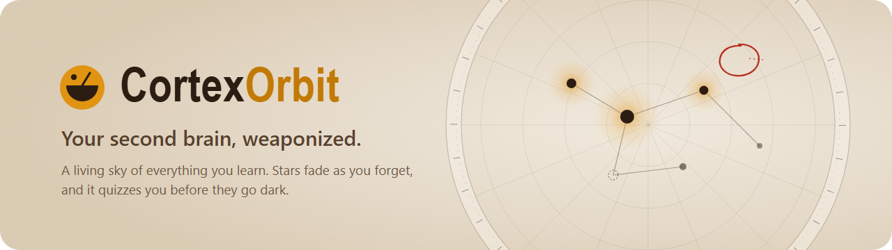
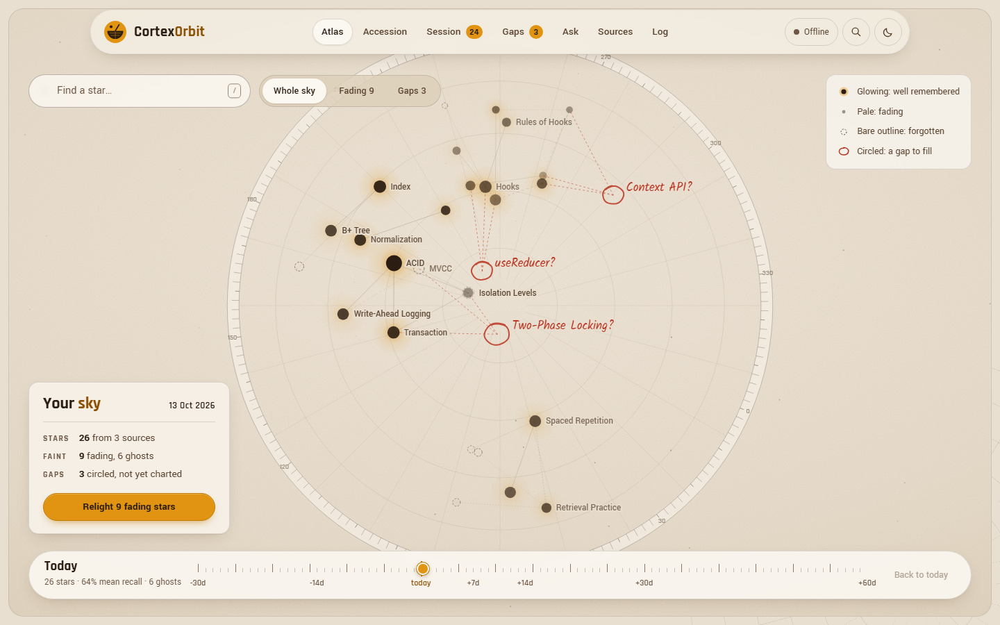
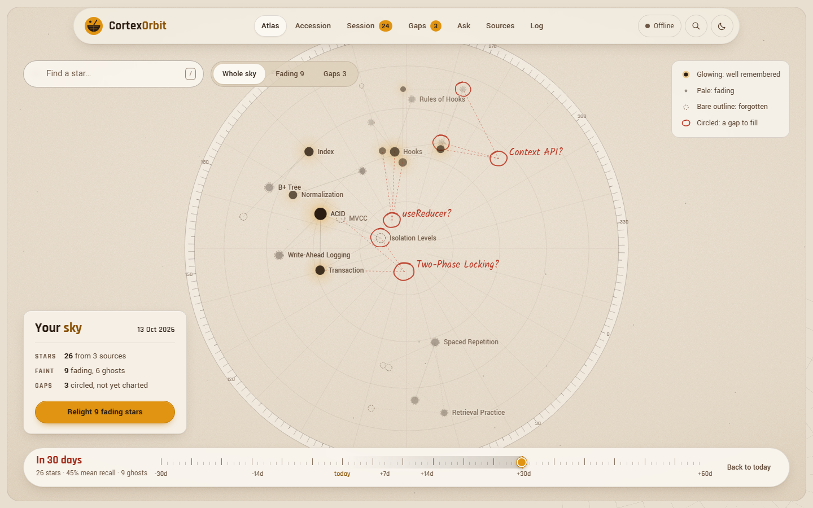
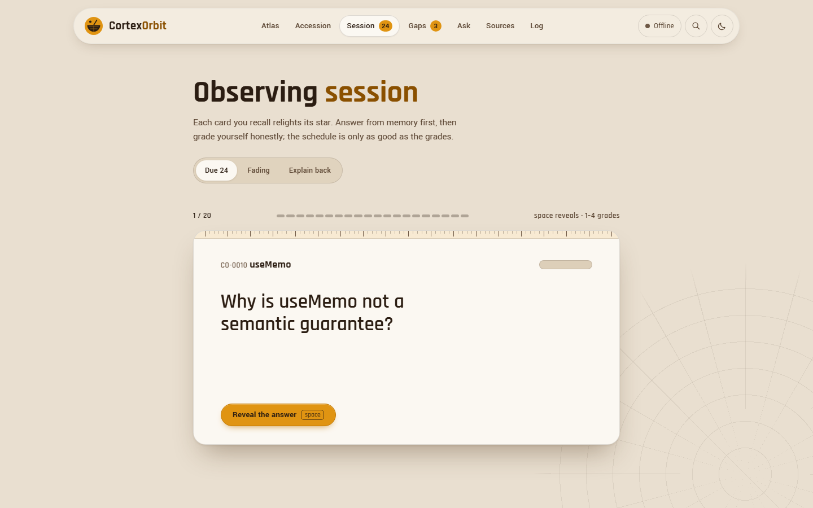
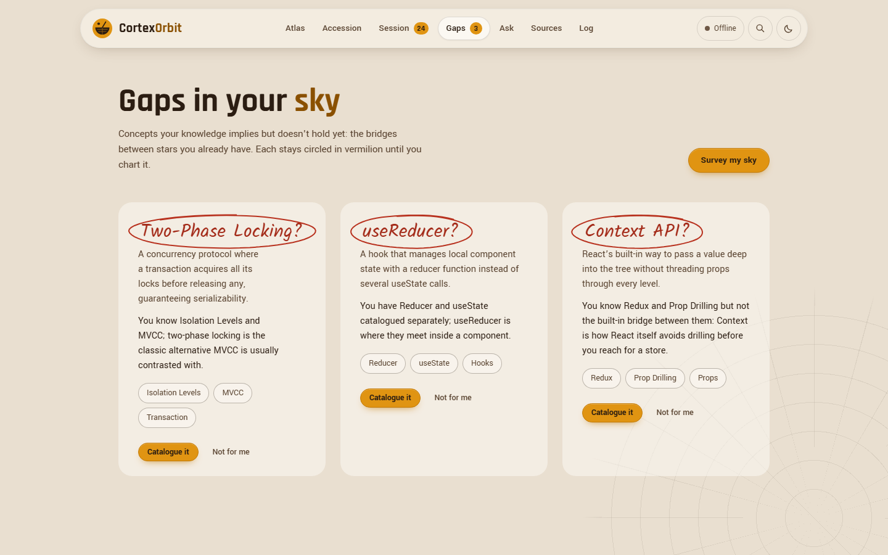
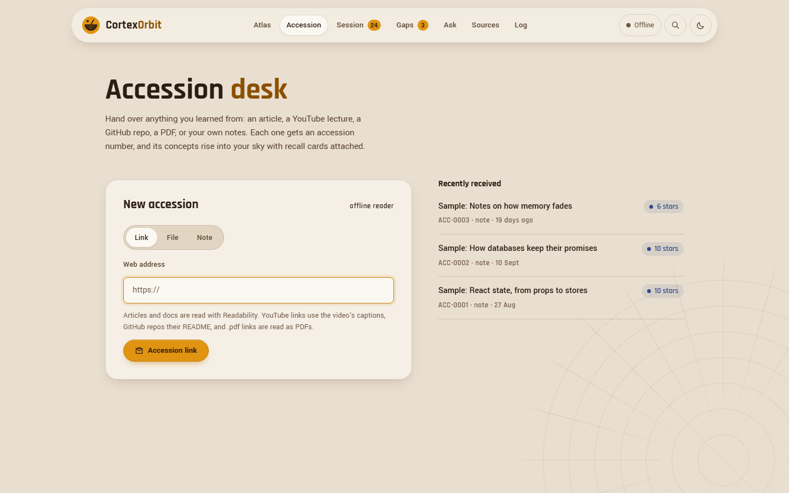
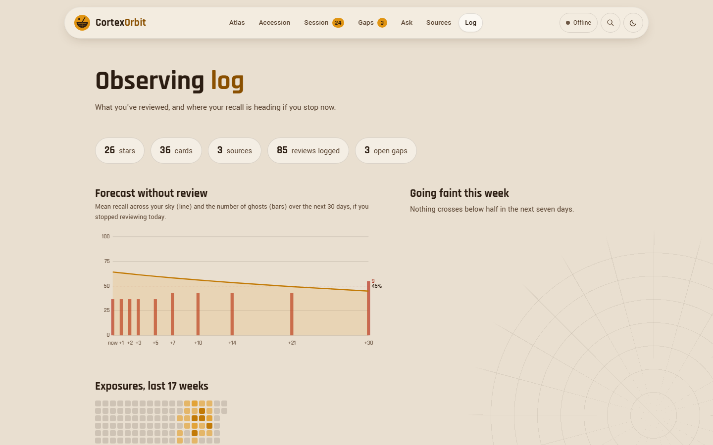
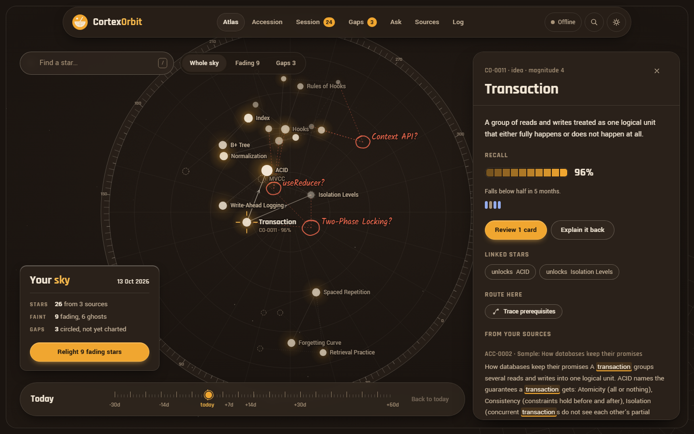
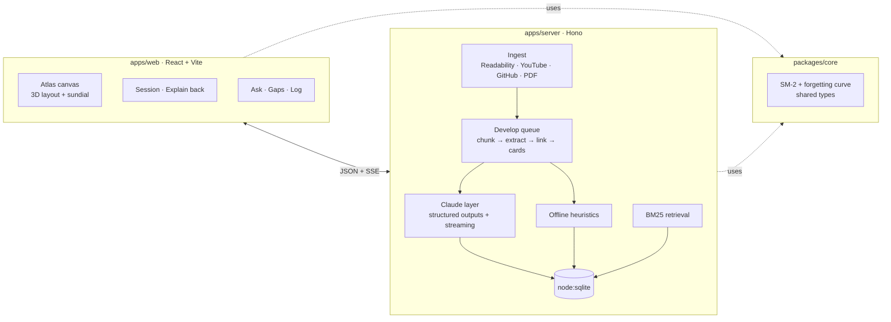

<p align="center">
  
</p>

<p align="center">
  <b>A living sky of everything you learn.</b><br />
  Every concept becomes a star. Stars fade as you forget them. CortexOrbit quizzes you before they go dark.
</p>

<p align="center">
  
  
  
  
  
  
</p>

<p align="center">
  <a href="#-quick-start">Quick start</a> ·
  <a href="#-features">Features</a> ·
  <a href="#-how-memory-is-modelled">Memory model</a> ·
  <a href="#-architecture">Architecture</a> ·
  <a href="#-design">Design</a> ·
  <a href="#-roadmap">Roadmap</a>
</p>

---

## The problem

Students and developers take in a lot: lectures, articles, docs, PDFs, repos. Within a month most of it is gone, and nothing tells you *which* parts are going or *what* you never had in the first place.

CortexOrbit takes whatever you learn from and turns it into a sky you can see forgetting. It schedules your reviews so the stars stay lit, and it circles the concepts your knowledge implies but doesn't yet contain.

<p align="center">
  
  <br /><sub><b>The atlas.</b> 26 concepts from three sources, drawn as stars on an engraved instrument face. Bright, haloed stars are well remembered; pale ones are fading; dashed outlines are forgotten. Red circles are gaps.</sub>
</p>

## ✦ Features

<table>
<tr>
<td width="50%" valign="top">

### 🪐 A 3D sky of what you know
Claude reads each source and pulls out the concepts worth remembering, how they relate (*prerequisite*, *part of*, *contrasts*, *related*), and recall cards for each. Concepts merge across sources, so your React notes and a Redux article end up linked. Drag to turn the sky, scroll to zoom, click a star to open it.

</td>
<td width="50%" valign="top">

### ☀️ The sundial: watch yourself forget
Drag the time dial up to 60 days ahead. Every star fades along its **real forgetting curve**, and the ones that would be gone by then get circled. Scrub back 30 days to see what your sky looked like. You can link a view directly with `?t=30`.

</td>
</tr>
<tr>
<td valign="top">

### 🗂️ Reviews that schedule themselves
Question-and-answer, fill-in-the-blank and multiple-choice cards, driven by **SM-2**. Every grade button shows the interval it would set. The whole session runs from the keyboard: `space` reveals, `1–4` grades, `a–d` picks an option.

</td>
<td valign="top">

### 🗣️ Explain it back
The Feynman technique, graded. Write an explanation from memory, and Claude grades it 0–5 **against your own sources** and lists exactly what you missed. A good explanation counts as a review for every card on that concept.

</td>
</tr>
<tr>
<td valign="top">

### ⭕ Gaps in your sky
*"You know Redux and Prop Drilling, but not the Context API, the bridge between them."* A survey finds the concepts that connect your clusters. One click has Claude write a short primer that ties the new concept to what you already know, then adds it to your sky.

</td>
<td valign="top">

### 💬 Ask your vault
Ask questions and get streamed answers that use **only your notes**, with every claim cited `[n]` to a passage shown in the margin. When your notes don't cover it, it says so instead of guessing.

</td>
</tr>
<tr>
<td valign="top">

### 📥 Learn from anything
Articles (via Readability), **YouTube** captions, **GitHub** READMEs, **PDFs** (by link or upload), Markdown files, and pasted notes. Each source gets an accession number like `ACC-0007`, and every concept a catalogue number like `CO-0042`.

</td>
<td valign="top">

### 🧭 And the rest
Prerequisite routes ("what do I need before this?"), merging duplicate concepts, a `Ctrl K` command palette, a 30-day decay forecast, a review calendar, **Anki** and Markdown export, a day/night theme, and a phone layout.

</td>
</tr>
</table>

<p align="center">
  
  <br /><sub><b>Thirty days from now, without review.</b> Mean recall drops from 64% to 45%. The stars about to be forgotten are circled, and the dial's shadow runs from today to day 30.</sub>
</p>

<table>
<tr>
<td width="50%"></td>
<td width="50%"></td>
</tr>
<tr>
<td align="center"><sub><b>Observing session.</b> Cards are graded from memory, keyboard first.</sub></td>
<td align="center"><sub><b>Gaps.</b> Concepts that would connect what you already know.</sub></td>
</tr>
<tr>
<td width="50%"></td>
<td width="50%"></td>
</tr>
<tr>
<td align="center"><sub><b>Accession desk.</b> Add a link, a file, or a note.</sub></td>
<td align="center"><sub><b>Observing log.</b> A forecast of what you'd lose if you stopped today.</sub></td>
</tr>
</table>

<p align="center">
  
  <br /><sub><b>Night.</b> The same stone by lamplight. Selecting a star opens its panel: recall, review history, linked stars, prerequisite route, and the passages it came from.</sub>
</p>

## 🚀 Quick start

You need **Node 22.13 or newer** (it uses the built-in `node:sqlite`; Node 24 is recommended).

```bash
git clone <your-repo-url> CortexOrbit && cd CortexOrbit
npm install
cp .env.example .env        # add ONE AI key (optional; free options below)
npm run seed                # optional: load a sample sky
npm run dev                 # web on :5173, API on :8787
```

Open **http://localhost:5173**.

To run a single production process on one port:

```bash
npm run build
PORT=5000 npm start         # PowerShell: $env:PORT=5000; npm start
```

Then open **http://localhost:5000**.

### 🔑 Pick an AI provider (free options included)

Put **one** key in `.env`. CortexOrbit detects it automatically, and the nav bar shows which provider is active.

| Provider | Cost | `.env` | Default model | Get a key |
|---|---|---|---|---|
| **Anthropic Claude** | Paid, best quality | `ANTHROPIC_API_KEY=` | `claude-opus-5-5` | [console.anthropic.com](https://console.anthropic.com) |
| **Google Gemini** | Free tier | `GEMINI_API_KEY=` | `gemini-2.5-flash` | [aistudio.google.com/apikey](https://aistudio.google.com/apikey) |
| **Groq** | Free tier, very fast | `GROQ_API_KEY=` | `llama-3.3-70b-versatile` | [console.groq.com/keys](https://console.groq.com/keys) |
| **OpenRouter** | Free `:free` models | `OPENROUTER_API_KEY=` | `meta-llama/llama-3.3-70b-instruct:free` | [openrouter.ai/keys](https://openrouter.ai/keys) |
| **Ollama** | Free, runs locally, no key | `AI_PROVIDER=ollama` | `llama3.1` | [ollama.com](https://ollama.com), then `ollama pull llama3.1` |

- **Change the model:** set `AI_MODEL`, for example `AI_MODEL=gemini-2.5-pro` or any OpenRouter model id.
- **Choose between keys:** if you have several keys, `AI_PROVIDER` picks which one to use.
- **Other services:** any other OpenAI-compatible endpoint works with `AI_BASE_URL`.
- **How the non-Claude providers are reached:** through their OpenAI-compatible APIs, with JSON output checked against the same schemas as the Claude path and up to three tries to get it right. Free models are less reliable at structured extraction than Claude, so if a source fails, try a larger model via `AI_MODEL`.

> **No key at all? It still works.** Every AI feature falls back to a local version: heuristic concept extraction, BM25 answers made from your own sentences, and word-overlap grading. The nav bar shows **Offline** so you always know which mode you're in.

| Script | What it does |
|---|---|
| `npm run dev` | API and web with hot reload |
| `npm run build` / `npm start` | Production build, then serve app and API from one port (`PORT`, default 8787) |
| `npm run seed` | Load the sample sky into an empty vault (`-- --reset` wipes it first) |
| `npm test` | Unit tests for the memory model |
| `npm run typecheck` | Strict TypeScript across all three packages |

| Environment variable | Default | Purpose |
|---|---|---|
| `ANTHROPIC_API_KEY` · `GEMINI_API_KEY` · `GROQ_API_KEY` · `OPENROUTER_API_KEY` | none | Any one turns on AI extraction, gaps, primers, grading and answers |
| `AI_PROVIDER` | auto | `anthropic`, `gemini`, `openrouter`, `groq` or `ollama` |
| `AI_MODEL` | per provider | Model for every AI call |
| `AI_BASE_URL` | per provider | Any OpenAI-compatible endpoint |
| `OLLAMA_HOST` | `http://localhost:11434` | Where Ollama is running |
| `CORTEX_OFFLINE` | none | Set to `1` to force offline mode even with a key |
| `CORTEX_DATA_DIR` | `./data` | Where `cortex.db` lives |
| `PORT` | `8787` | Server port |

## 🧠 How memory is modelled

Each card keeps its own **SM-2** state: ease, interval, repetitions, and lapses. A concept's recall is the average across its cards. Recall decays along a forgetting curve anchored to the SM-2 schedule:

$$R(t) = 0.9^{\,\Delta t \,/\, \text{interval}}$$

So a card is at exactly **90% recall on its due date**. Reviewing on time keeps everything above that line, and each successful review stretches the interval, which flattens the curve. A card you've never reviewed starts with a one-day interval.

How a star looks follows directly from its recall:

| Recall | On the sky |
|---|---|
| ≥ 85% | Dense pigment with a wide saffron halo |
| 65–85% | Solid, with a smaller halo |
| 40–65% | Pale and shrinking |
| < 40% | Pigment gone, only a dashed outline left (a "ghost") |

The sundial runs this same function in the browser at any date from −30 to +60 days, so what you see is exactly what the scheduler believes.

## 🏗️ Architecture



```
packages/core     shared types, SM-2, forgetting curve, catalogue numbering (tested)
apps/server       Hono API on node:sqlite
  src/ingest      fetchers (Readability, YouTube captions, GitHub README, PDF via unpdf) + chunker
  src/ai          provider.ts (picks the provider), claude.ts (Anthropic SDK), compat.ts
                  (Gemini / OpenRouter / Groq / Ollama), offline.ts (heuristic fallbacks)
  src/pipeline.ts the develop queue: fetch → chunk → extract → link → cards; gap survey; primers
  src/search.ts   BM25 retrieval for grounded answers
apps/web          React + Vite
  src/atlas       3D force layout, canvas renderer, sundial, concept panel
  src/pages       accession, session, gaps, ask, sources, log
docs/images/    screenshots and banner assets
data/           cortex.db (gitignored)
```

### How the AI is used

Every prompt and schema is in [`apps/server/src/ai/claude.ts`](apps/server/src/ai/claude.ts). With a non-Claude key, the same prompts and schemas go through [`compat.ts`](apps/server/src/ai/compat.ts), which uses JSON mode and checks each reply against the same Zod schemas. On the Claude path:

- **Model:** `claude-opus-5-5` by default, with adaptive thinking. Effort is set per task: `medium` for extraction and gap surveys, `low` for grading and answers.
- **Structured outputs:** extraction, gaps, primers and grades are validated against Zod schemas, so a malformed response never reaches the database.
- **Grounding:** answers stream over SSE and may cite only the numbered passages retrieved from your own vault.
- **Refusal fallbacks:** if a safety classifier declines a request, the API retries it on Anthropic's recommended fallback model within the same call. Remove the `FALLBACK` spread in that file to turn this off.
- **Cost:** sources are processed one at a time, so a large PDF costs about one extraction call per ~120k characters.

## 🎨 Design

**Sandstone Observatory.** The look comes from Jantar Mantar, the 18th-century stone observatories of Jaipur and Delhi.

- The atlas is an **engraved sandstone instrument**: declination circles, hour lines, and an inlaid **marble scale ring** whose markings turn as you drag the sky.
- Remembered concepts **glow saffron**. Forgotten ones wear away to bare carved outlines.
- Gaps are circled in a scribe's **vermilion**. Finished and remembered states use **Jaipur blue-pottery indigo**.
- The time control is a **sundial strip** that casts a shadow from today into the future.
- All type comes from the **Indian Type Foundry**: Rajdhani for headings and numbers, Yantramanav for the interface, Kalam for the scribe's notes.
- Night mode is the same stone by lamplight.

Colour tokens and styling rules are defined in `apps/web/src/styles/tokens.css` and `apps/web/src/styles/app.css`.

## 🗺️ Roadmap

- **Exam mode:** pick a date and the scheduler compresses intervals so everything peaks that day.
- **Confusion pairs:** cards generated automatically from *contrasts* links ("Redux vs Context: when would you pick each?").
- **Personal forgetting curves:** fit memory stability from your own review history (FSRS-style).
- **Browser extension:** add the current page and your highlights in one click.
- **Shared skies:** compare yours with a study partner's and find the stars only one of you has.
- **Semantic retrieval:** embeddings alongside BM25 for answers.

---

<p align="center">
  <sub>The sample sky is synthetic demonstration data, clearly labelled "Sample". Your vault lives only in <code>data/cortex.db</code> on your machine.</sub>
</p>
